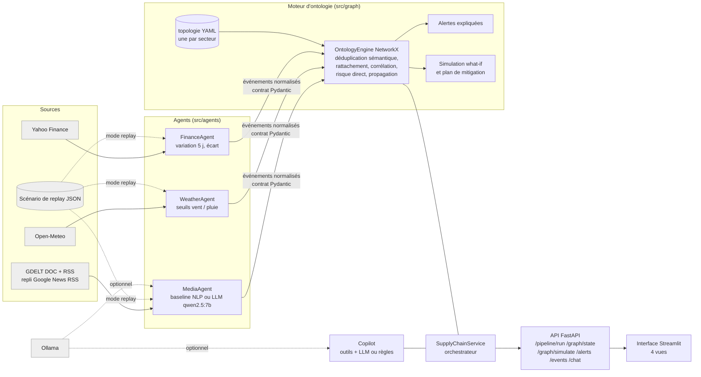

# Alerte Précoce Supply Chain

Projet INGE3 n°6 : anticiper les crises de chaîne d'approvisionnement à partir de l'actualité, de la météo, des
marchés et d'un graphe de dépendances fournisseurs.

L'application transforme le notebook `volet_medias_ingestion_actualites_v2.ipynb` en produit complet :
trois agents de collecte, un moteur de risque sur graphe NetworkX, une API FastAPI, un tableau de bord Streamlit
et un assistant conversationnel.

> **Données simulées.** Les fournisseurs de `data/topology.yaml` et le scénario
> `crisis_asia_semiconductors` sont inventés pour la démonstration (préfixe `replay:`). Les ports et les villes
> sont réels. Le mode live, lui, n'utilise que des données réelles et ne les remplace jamais par le scénario.

Sommaire : [Démarrage](#démarrage-rapide) · [Architecture](#architecture) · [Sources du mode live](#sources-du-mode-live) ·
[Règles de calcul](#règles-de-calcul-du-risque) · [API](#api) · [Interface](#interface) · [Démonstration](#scénario-de-démonstration-5-minutes) ·
[Figures de soutenance](#figures-de-soutenance) · [Adapter à votre entreprise](#adapter-le-projet-à-votre-entreprise) · [Tests](#tests)

## Démarrage rapide

```bash
python -m venv .venv
.venv\Scripts\activate            # Windows   (Linux / macOS : source .venv/bin/activate)
pip install -r requirements.txt
python -m spacy download xx_ent_wiki_sm      # facultatif : sans lui, l'agent médias utilise les référentiels seuls

uvicorn src.api.main:app --port 8000         # terminal 1 : API, documentation sur http://localhost:8000/docs
pytest                                       # 155 tests
```

### Interface web React (recommandée)

Prérequis : Node.js 18 ou plus récent. L'API doit tourner sur http://localhost:8000 (terminal 1 ci-dessus).

```bash
cd frontend
npm install && npm run dev                   # terminal 2 : interface sur http://localhost:5173
```

- `npm run build` vérifie les types (TypeScript strict) et produit `frontend/dist/` ; `npm run preview` le sert.
- Autre adresse d'API : `VITE_API_URL=http://mon-serveur:8000 npm run dev` (PowerShell : `$env:VITE_API_URL="..."; npm run dev`).
- L'API autorise les requêtes de `http://localhost:5173` (middleware CORS dans `src/api/main.py`).

### Interface Streamlit (repli)

```bash
streamlit run app/Tour_de_controle.py        # interface historique sur http://localhost:8501
```

L'interface fonctionne aussi seule : si l'API ne répond pas, elle utilise un moteur embarqué (indiqué en bas de la
barre latérale).

Avec Docker : `docker compose up --build`, puis http://localhost:8501 (interface) et http://localhost:8000/docs (API).

### LLM local (facultatif)

```bash
ollama pull qwen2.5:7b
set USE_LLM=true                  # Linux / macOS : export USE_LLM=true
```

`USE_LLM=true` active le LLM pour le copilot (appel d'outils). Pour l'extraction des événements médias, cocher
« Extraction par LLM local » dans la barre latérale. Sans serveur Ollama, tout bascule sur la baseline : rien ne plante.
Autres variables : `LLM_BACKEND` (`ollama` ou `openai`), `LLM_BASE_URL`, `LLM_MODEL`, `LLM_TIMEOUT_S`, `LLM_API_KEY`.

## Architecture



```
src/
  config.py                 réglages (variables d'environnement)
  schemas/events.py         contrat commun, graphe, alertes, simulation, API
  agents/base.py            BaseAgent : collect_live, collect_replay, extract_events, run
  agents/media_sources.py   GDELT, RSS, GKG (repris du notebook, sections 0 et 1)
  agents/media_nlp.py       déduplication, entités, classification, événements (sections 2 à 5)
  agents/media_agent.py     agent médias asynchrone
  agents/weather_agent.py   agent météo
  agents/finance_agent.py   agent finance
  graph/ontology_engine.py  moteur de risque
  copilot/assistant.py      assistant conversationnel
  service.py                orchestrateur du pipeline
  api/main.py               API FastAPI
  utils/                    http_get, client LLM, fonctions de texte
data/topology.yaml          topologie par défaut (électronique de puissance, 30 nœuds)
data/topologies/            topologies d'autres secteurs (pharma_helvia.yaml)
data/replay_scenarios/      scénarios : crisis_asia_semiconductors, crisis_pharma_api
scripts/
  build_scenario.py           fabrique les deux scénarios livrés
  generate_sector_config.py   topologie + scénario modèle pour un secteur ; vérification d'une topologie
  export_soutenance.py        figures PNG dans docs/figures/
  check_feeds.py              teste les sources médias du mode live depuis votre poste
docs/figures/               figures de soutenance
app/                        interface Streamlit
tests/                      pytest
```

## Ce qui vient du notebook v2

| Décision du notebook | Où elle se trouve maintenant |
|---|---|
| Contrat `event, date, location, entities, media, donnees_manquantes` | `NormalizedEvent`, complété par `weather`, `finance` (README du projet) et `meta` |
| LLM `qwen2.5:7b` en option, prompt strict, repli sur la baseline | `media_nlp.py` (`LLM_SYSTEM_PROMPT` inchangé, `llm_event`, `extract_events`) |
| Date, coordonnées, identifiants, `media` toujours calculés par le code | `MediaNLP._assemble` ; testé avec un LLM qui hallucine |
| `http_get` : essais, pauses croissantes, abandon immédiat sur 403 / 404 | `src/utils/http.py` |
| En-têtes de navigateur | `src/config.py` (`HTTP_HEADERS`) |
| GDELT : une seule requête, une pause puis un seul nouvel essai | `ingest_gdelt_live` (plus un cache et un repli, voir ci-dessous) |
| RSS : refus du site ≠ panne réseau, arrêt après 3 pannes | `ingest_rss` |
| Règle zéro démo, `status: success / error`, `degraded` | `BaseAgent.run`, appliqué aux trois agents |
| L'agent médias ne calcule aucun score | la gravité est calculée dans `ontology_engine.py` |
| « Brancher les référentiels du bloc 4 » | entreprises et lieux lus dans `topology.yaml` |

Non repris : la classification zero-shot NLI, la déduplication par embeddings, la table des dates citées dans le
texte et les exports CSV. Le mot-clé `typhon` a été ajouté à la liste des catastrophes.

## Sources du mode live

| Source | Agent | En cas de panne |
|---|---|---|
| GDELT DOC 2.0 (une requête, 100 articles) | médias | cache disque de 15 minutes ; après une limite de débit, GDELT n'est plus rappelé pendant 5 minutes |
| Google News RSS (mêmes mots-clés que GDELT) | médias | utilisé seulement si GDELT refuse pour limite de débit |
| 12 flux RSS (presse économique et supply chain) | médias | un flux en erreur est sauté ; adresses de rechange possibles |
| Open-Meteo (une requête pour tous les hubs) | météo | `status: error` |
| Yahoo Finance (`yfinance`) | finance | `partial` si certains instruments manquent |

- **Cache GDELT.** La réponse est gardée 15 minutes dans `data/cache/gdelt/` : cliquer plusieurs fois sur « Exécuter le
  pipeline » pendant une démonstration ne renvoie pas la requête. Le rapport de la source indique alors `cache: true`.
- **Repli Google News.** Quand GDELT répond « limite de débit » même après la pause, l'agent interroge
  `news.google.com/rss/search` avec la même requête. Ce sont des articles réels (identifiants `gnews:`). Le résultat est
  marqué incomplet (`degraded`), car Google News ne couvre pas les 65 langues de GDELT, et `gdelt` reste `failed` dans le
  rapport : le repli ne cache pas la panne.
- **Flux RSS.** `latribune_industrie` (HTTP 404) est remplacé par `supplychaindive` ; `freightwaves` est ajouté.
  Avant une démonstration : `python scripts/check_feeds.py --all` teste chaque source depuis votre poste.

Relevé du 16/11/2026 sur un poste personnel, après ces corrections : `rss`, `gdelt`, `open_meteo` et `yfinance` répondent
tous `ok`, 19 événements réels remontent.

### Choisir l'entreprise surveillée en live

En mode Live, la barre latérale propose un sélecteur « Topologie (entreprise cible) ». Il liste la topologie par défaut,
les fichiers `data/topology*.yaml` (par exemple `data/topology_pharma.yaml`) et ceux de `data/topologies/`. La topologie
choisie est chargée à l'exécution : la météo interroge ses hubs, la finance ses instruments, et les articles sont rattachés
à ses nœuds. Par l'API : `POST /pipeline/run` avec `{"mode": "live", "topology": "topologies/pharma_helvia.yaml"}` ;
`GET /topologies` donne la liste. En replay, c'est le scénario qui fixe la topologie.

### Rattachement élargi des articles (mode live, sans LLM)

Un article réel cite rarement un fournisseur de la base. Quand la baseline ne trouve ni entreprise ni site du référentiel,
elle rattache l'événement par un indice plus large, dans cet ordre :

1. le nom d'une matière première de la topologie (« lithium », « terres rares ») ;
2. un mot-clé sectoriel d'un nœud (champ `keywords` de la topologie : « semiconductor », « principe actif ») ;
3. à défaut seulement, un pays : tous les nœuds situés dans ce pays, 8 au plus.

Les nœuds ainsi rattachés portent le rôle `exposé` (et non `touché`), l'événement a une confiance de 0,40, et
`donnees_manquantes` contient `rattachement_exact`. Dans le moteur, un lien élargi pèse 0,40 fois un lien exact et ne
corrobore jamais un signal exact. Un article seul rattaché de cette façon ne peut pas déclencher d'alerte : il fait passer
des nœuds en « à surveiller ». Un article sans aucun indice reste hors graphe.

Réglage : variable `BROAD_LINKING` = `live` (par défaut), `always` (aussi en replay) ou `never`. Les scénarios de replay
ne l'utilisent pas : leurs chiffres et les figures sont inchangés. Le chemin LLM ne l'utilise pas non plus.

## Règles de calcul du risque

Toutes les constantes sont dans `src/graph/ontology_engine.py`. Ce sont des règles d'experts posées pour la
démonstration : elles ne sont pas calibrées sur des crises réelles, et c'est le rôle du backtesting de le faire.

| Étape | Règle |
|---|---|
| Déduplication sémantique | événements médias fusionnés si leurs textes se ressemblent (TF-IDF, cosinus ≥ 0,50), à moins de 3 jours d'écart et sur un nœud commun |
| Rattachement | entités « touché » (identifiant ou alias), puis lieu de l'événement : poids 1. Entités « exposé » (rattachement élargi) : poids 0,40 |
| Corrélation | même nœud, même famille d'aléa, moins de 3 jours d'écart → un seul signal |
| Gravité | gravité de base du type × intensité (rafales, pluie, variation de prix ; 1 pour un article) × poids du lien |
| Confiance | 0,55 + 0,10 par source supplémentaire (2 au plus) + 0,25 par agent supplémentaire |
| Risque direct | 1 − ∏(1 − gravité × confiance × fraîcheur) |
| Perte d'un intrant | Σ part de la source × risque de la source (la redondance dilue) |
| Risque propagé | transmission × perte de l'intrant le plus touché ; transmission = 0,95 × (1 − stock / 120 j) |
| Risque total | 1 − (1 − direct) × (1 − propagé) |
| Niveaux | à surveiller ≥ 15 %, alerte ≥ 35 %, critique ≥ 60 % |
| Indice global | moyenne des risques pondérée par la criticité (produits finis × 3, usines × 2), sur 100 |

La déduplication se fait à deux niveaux. L'agent médias regroupe d'abord les articles aux titres proches (notebook v2).
Le moteur fusionne ensuite les événements qui racontent le même incident, avant de calculer la gravité : sans cela, un
incident classé « logistique » par un article et « catastrophe » par un autre compterait deux fois. Le TF-IDF ne rapproche
pas deux langues. Sur les deux scénarios livrés, cette seconde passe ne fusionne rien : l'agent a déjà fait le travail.

Limites connues :
- un port traversé par plusieurs flux propage le risque du flux le plus touché à tous ses clients (les topologies
  fournies l'évitent : un flux principal par port d'arrivée) ;
- une usine transmet son risque à tous ses produits, même ceux qui n'utilisent pas l'intrant touché.

## API

| Méthode | Chemin | Rôle |
|---|---|---|
| POST | `/pipeline/run` | lance les agents puis le moteur. Corps : `{"mode": "replay", "scenario": "...", "day": 3}` ou `{"mode": "live", "topology": "..."}` (`topology` facultatif) |
| GET | `/graph/state` | nœuds (risque direct, propagé, total, chemin) et liens |
| POST | `/graph/simulate` | what-if : `{"node_id": "port_kaohsiung", "severity": 0.8}`. L'état réel n'est pas modifié |
| GET | `/alerts` | alertes priorisées et expliquées ; filtres `level`, `agent` |
| GET | `/events` | événements normalisés et signaux corrélés |
| POST | `/chat` | copilot : `{"message": "...", "history": [], "context": {}}` |
| GET | `/scenarios`, `/topologies`, `/health` | scénarios et topologies disponibles, état du service |

`status: "error"` sur `/pipeline/run` signale une panne de collecte, jamais une absence d'alerte. L'état précédent
est alors conservé (sauf si la topologie vient de changer : le graphe est alors vide). Une topologie introuvable donne 404,
une topologie invalide 400.

## Interface

### Front-end React (`frontend/`)

React 18 + TypeScript + Vite + Tailwind CSS + Framer Motion + Lucide. Thème clair, couleurs pastel par domaine
(Médias jaune, Finance bleu, Météo vert) et niveaux de risque doux (sauge, miel, corail, prune).

| Zone | Contenu | Endpoints |
|---|---|---|
| Barre de pilotage | Replay (scénario, curseur de jour, résumé narratif) ou Live (topologie), LLM local, « Lancer l'analyse », état des 3 sources | `GET /health`, `GET /scenarios`, `GET /topologies`, `POST /pipeline/run` |
| Tour de contrôle | Phrase de synthèse, 3 indicateurs, courbe de l'indice, chronologie des signaux, alertes prioritaires | `GET /graph/state`, `GET /alerts`, `GET /events` |
| Chaîne & simulation | Graphe d'ontologie (formes par type), carte mondiale, tableau (stocks, direct / propagé, chemin), panneau What-If | `GET /graph/state`, `POST /graph/simulate` |
| Preuves & traçabilité | Tiroir latéral : explication en clair, chemin, signaux, preuves multi-sources (exact / élargi ×0,40), JSON brut | `GET /alerts`, `GET /events` |
| Slime | Compagnon pixel art à droite de l'écran (réagit au scroll), bulle de statut, chat Copilot avec questions rapides | `POST /chat` |

```
frontend/src/
  api.ts  types.ts  store.tsx  theme.ts      client HTTP, types des schémas Pydantic, état global, palette
  components/Header.tsx                      barre de pilotage
  components/Dashboard.tsx RiskChart.tsx SignalTimeline.tsx
  components/ChainView.tsx OntologyGraph.tsx WorldMap.tsx ChainTable.tsx WhatIfPanel.tsx
  components/EvidenceDrawer.tsx              tiroir de preuves
  components/Companion.tsx Slime.tsx         compagnon Slime et chat Copilot
public/copilot/slime_*.png                   sprites du Slime (générés, voir ci-dessous)
sprites_src/                                 planches sources etats_slime et slime_situations
```

**Compagnon Slime.** Seul personnage de l'interface, ancré en bas à droite (immobile, aucun suivi du scroll), il
ouvre le chat Copilot et sert d'avatar aux réponses. Les 15 sprites (3 couleurs de risque × 5 poses) sont découpés
depuis les planches `etats_slime` et `slime_situation_{bleu,jaune,rouge}` (`.png`, `.jpg` ou `.jpeg`, à la racine,
dans `assets/` ou dans `frontend/sprites_src/`) par `python scripts/prepare_copilot_sprites.py` : fond blanc retiré
par flood-fill depuis les bords, recadrage, retour à la grille native du pixel art, corps ramenés à la même largeur
(`--hd` garde la pleine résolution). Affichage avec `image-rendering: pixelated`.

| Couleur | Indice de risque global |
|---|---|
| `calm` (bleu) | normal |
| `warning` (jaune) | à surveiller |
| `critical` (rouge) | alerte ou critique |

| Pose | Quand |
|---|---|
| `thinking` | appel au Copilot ou analyse en cours (affiché au moins 0,7 s) |
| `happy` | 4 s après une réponse réussie |
| `sleepy` | plus de 2 min sans interaction, avec une respiration lente (`scaleY` 0,97 ↔ 1 sur 4,5 s) ; `?slimeSleep=10` dans l'URL raccourcit le délai |
| `announce` | ouverture du Copilot (message d'accueil) ou conseil affiché dans sa bulle |
| `idle` | le reste du temps |

La conversation du Copilot est vidée quand on relance le pipeline sur une autre chaîne ou un autre mode.

### Streamlit (`app/`, repli)

- **Barre latérale persistante.** Mode, scénario, jour, topologie et option LLM gardent leur valeur quand on change de
  page ; le panneau what-if aussi. Revenir de Live à Replay retrouve le scénario et le jour choisis.
- **Copilot.** La conversation est vidée à chaque exécution du pipeline et à chaque changement de mode, de scénario ou de
  topologie : une réponse affichée décrit toujours l'état chargé. Le bouton « Effacer la conversation » est dans la page.
  Changer seulement le jour ne vide rien tant qu'on n'a pas exécuté.
- **Rattachement.** L'onglet « Événements des agents » indique pour chaque événement s'il est rattaché de façon exacte,
  élargie, ou pas du tout.

## Scénario de démonstration (5 minutes)

Préparation : API et interface lancées, page « Tour de contrôle » ouverte, mode « Replay scénario ».

| Temps | Action | Ce qu'il faut montrer |
|---|---|---|
| 0:00 | Jour 1, « Exécuter le pipeline » | Indice à 6 / 100, aucune alerte. Dans la chronologie, un cercle vide : un article sur un typhon, pas encore rattaché au graphe. L'agent météo, lui, voit déjà une prévision de rafales à Kaohsiung. C'est le signal faible. |
| 0:45 | Page « Graphe et simulation », nœud « Port of Kaohsiung », gravité 80 %, activer la simulation | L'onde de choc : Rotterdam, l'usine de Stuttgart, les deux usines d'assemblage, les trois produits finis. L'indice simulé monte, l'état réel ne bouge pas. Lire le plan de contournement (Keelung, Waal, fret aérien). |
| 1:45 | Désactiver la simulation, jour 3, exécuter | Ce que la simulation annonçait est arrivé : port et usine de puces en critique, signal « climat » corroboré par deux agents. L'usine de Stuttgart est en alerte depuis le jour 2 sans qu'aucun article ne la cite. |
| 2:30 | Page « Alertes et preuves », alerte « Rhein Power Modules » | La règle, le chemin Kaohsiung → Rotterdam → Stuttgart, les `source_id`. Onglet « Événements » : le JSON normalisé d'un article, avec le bloc `weather` rempli par validation croisée. |
| 3:15 | Jour 5, exécuter, retour à la Tour de contrôle | La grève de Rotterdam et la flambée du fret s'ajoutent : trois agents contribuent. L'indice monte peu, car la route des puces était déjà coupée. |
| 3:45 | Jour 7, exécuter | Les articles du jour 6 et du jour 7 confirment l'arrêt de Stuttgart puis de Valenciennes. Le système avait mis Stuttgart en alerte au jour 2 : quatre jours d'avance sur la presse (figure `anticipation_plant_ecu_de.png`). |
| 4:15 | Page « Copilot » : « Produits menacés », « Fermeture de Rotterdam », « Plan de contournement » | Réponses chiffrées, chemin dans le graphe, outils appelés visibles. Poser une question libre : « Quels fournisseurs alternatifs pour Formoz ? ». |
| 4:50 | Barre latérale : mode « Live » (sans exécuter si le réseau est incertain) | Dire que les mêmes agents lisent GDELT, les flux RSS, Open-Meteo et Yahoo Finance, et qu'une panne s'affiche comme une panne. |

L'avance de quatre jours est celle d'un scénario écrit pour la démonstration. La vraie mesure demande le backtesting
sur Nexperia, Helene, la grève des ports et les terres rares.

Pour montrer que l'outil n'est pas lié à un secteur : choisir le scénario « Pharmacie » dans la barre latérale et exécuter.
Le graphe, les alertes et les questions rapides du copilot changent de chaîne.

## Figures de soutenance

```bash
python scripts/export_soutenance.py                                              # scénario électronique, usine de Stuttgart
python scripts/export_soutenance.py --scenario crisis_pharma_api --node plant_ff_fr
```

| Fichier (`docs/figures/`, 3000 px de large) | Contenu |
|---|---|
| `indice_global_crisis_asia_semiconductors.png` | indice de risque global du jour 1 au jour 7 : 6,0 → 40,6 |
| `anticipation_plant_ecu_de.png` | risque de l'usine de Stuttgart calculé par le graphe, comparé au risque direct porté par les articles qui la citent : alerte au jour 2, premier article au jour 6 |
| `indice_global_crisis_asia_semiconductors.txt` | légende jour par jour, à coller sous la figure |

Le script rejoue le scénario jour par jour : les chiffres des figures sont ceux du moteur, aucun n'est écrit en dur.

## Adapter le projet à votre entreprise

Un scénario porte sa propre chaîne d'approvisionnement : la clé `meta.topology` d'un scénario désigne un fichier YAML de
`data/`. Quand on lance ce scénario, le service charge cette topologie et reconstruit le moteur, les agents et le copilot.

### 1. Générer un point de départ

```bash
python scripts/generate_sector_config.py --list
python scripts/generate_sector_config.py --sector pharma --company "Ma Société" --days 7
```

Le script écrit `data/topologies/pharma_ma_societe.yaml` et `data/replay_scenarios/pharma_ma_societe_modele.json`
(scénario vide mais valide). Gabarits disponibles : `pharma` (19 nœuds) et `generique` (9 nœuds, à tout renommer).
Les fournisseurs des gabarits sont inventés : ce sont des exemples de structure.

### 2. Décrire votre chaîne dans la topologie

| Bloc | Champs | À savoir |
|---|---|---|
| `nodes` | `id`, `name`, `type`, `tier`, `criticality` | `type` : `matiere_premiere`, `fournisseur`, `port`, `hub`, `usine`, `produit_fini`. `criticality` de 0 à 1 : poids du nœud dans les priorités et l'indice global |
| | `place`, `country`, `lat`, `lon` | lieu réel : il sert à rattacher les articles et à interroger la météo (`weather_watch: true`) |
| | `aliases`, `company: true` | noms sous lesquels la presse cite le nœud ; `company` l'ajoute au référentiel entreprises de l'agent médias |
| | `keywords` | mots-clés sectoriels (« semiconductor », « principe actif ») : en live, un article qui les contient sans citer de site est rattaché au nœud avec une confiance de 0,40 |
| | `stock_days` | jours de stock chez le nœud : plus il y en a, moins le risque amont se transmet |
| `edges` | `source`, `target`, `input`, `dependency` | `source` fournit `target`. Pour une cible et un `input` donnés, la somme des `dependency` vaut 1 : 0,7 + 0,3 = deux sources |
| | `backup: true`, `capacity`, `lead_time_days` | lien de secours inactif (`dependency: 0`), proposé dans le plan de contournement ; `capacity` = part activable |
| `gazetteer` | `name`, `aliases`, `lat`, `lon` | pays et régions sans nœud, pour que l'agent médias les reconnaisse |
| `market_watch` | `id`, `name`, `yf`, `nodes` | instrument suivi par l'agent finance ; `yf` = symbole Yahoo Finance utilisé en live ; `nodes` = nœuds touchés quand il décroche |

Conseils : commencer par les produits finis et remonter ; un intrant = un `input` ; garder un flux principal par port
d'arrivée ; donner à chaque fournisseur les alias que la presse emploie vraiment.

### 3. Vérifier

```bash
python scripts/generate_sector_config.py --check data/topologies/pharma_ma_societe.yaml
```

La commande signale les erreurs (lien vers un nœud inconnu, parts qui ne font pas 1, cycle) et liste les intrants à source
unique : ce sont vos points de fragilité.

### 4. Écrire un scénario de replay

Un scénario est un fichier JSON de `data/replay_scenarios/` avec quatre blocs :

```json
{
  "meta": {"id": "ma_crise", "title": "Titre affiché", "fictional": true, "topology": "topologies/pharma_ma_societe.yaml",
           "start_date": "2026-03-02", "days": 5, "storyline": {"1": "Ce qui se passe le jour 1"}},
  "media": [{"source_id": "replay:ma_crise:001", "published_at": "2026-03-02T08:00:00Z", "language": "French",
             "title": "Titre de l'article", "text": "Texte ou résumé"}],
  "weather": [{"node_id": "port_antwerp", "date": "2026-03-04", "issued": "2026-03-02", "wind_max_kmh": 90,
               "gust_max_kmh": 140, "precip_mm": 120, "weather_code": 65, "source_id": "replay:meteo:port_antwerp:2026-03-04:prevision-J1"}],
  "finance": {"FRET_INDE_EUROPE": [{"date": "2026-01-16", "close": 100.0}, {"date": "2026-01-17", "close": 100.3}]}
}
```

- `media` : le pipeline ne voit un article qu'à partir de sa date de publication. Écrire des titres factuels, avec le nom
  du site ou de l'entreprise tel qu'il figure dans les alias. Pour une crise réelle, n'utiliser que de vrais articles et
  mettre `fictional: false`.
- `weather` : un relevé a `issued` = `date` ; une prévision a `issued` antérieur et devient visible ce jour-là. Un
  événement est créé au-delà de 90 km/h de rafales, 75 km/h de vent moyen ou 60 mm de pluie.
- `finance` : un cours par jour et par instrument, avec au moins 25 jours d'historique avant le premier jour. Un événement
  est créé au-delà de 8 % de variation sur 5 séances.
- Le plus simple est de partir du modèle généré (météo calme, cours plats) et d'y ajouter vos exceptions, ou de copier la
  description `PHARMA` de `scripts/build_scenario.py`, qui fabrique le scénario pharmacie livré.

### 5. Lancer

Le scénario apparaît dans la liste de la barre latérale ; sa topologie se charge toute seule. Pour le mode live sur votre
chaîne : la choisir dans le sélecteur « Topologie (entreprise cible) ». La variable d'environnement
`SC_TOPOLOGY=topologies/pharma_ma_societe.yaml` en fait la topologie par défaut au lancement de l'API.

Le scénario livré `crisis_pharma_api` (entreprise fictive Helvia Pharma, 6 jours) suit ce schéma : contrôle chinois des
exportations d'intermédiaires, inondations chez le fournisseur indien de principe actif, cyberattaque au port d'Anvers,
puis baisse de production à l'usine de Tours. Indice : 16,0 → 53,8.

## Tests

```bash
pytest                      # tout
pytest tests/test_agents.py -k llm
```

| Fichier | Ce qui est vérifié |
|---|---|
| `test_schemas.py` | contrat Pydantic : clés interdites, types, dates, bornes, « aucun fait sans source » |
| `test_ontology_engine.py` | topologie, cascade, redondance, stock, corrélation météo + médias, alertes expliquées |
| `test_simulation.py` | what-if sans effet sur l'état réel, monotonie, alternatives, plan de mitigation |
| `test_agents.py` | replay des trois agents, déduplication, règle zéro démo, RSS, GKG, LLM qui hallucine, replis |
| `test_pipeline.py` | crise sur 7 jours, alerte précoce, pas de fuite du futur, pannes partielles et totales |
| `test_copilot.py` | routage, questions de démonstration, appel d'outils par un LLM simulé, replis |
| `test_api.py` | endpoints, codes 404 et 422, filtres |
| `test_app_smoke.py` | les quatre pages Streamlit s'exécutent, panneau what-if, chat, passage au scénario pharmacie |
| `test_live_sources.py` | cache GDELT, repli Google News, période de repos, flux de rechange |
| `test_sectors.py` | générateur de configuration, scénario pharmacie, changement de topologie, figures |
| `test_final_adjustments.py` | rattachement élargi, topologie en live, barre latérale persistante, remise à zéro du copilot |

Les tests n'appellent ni Internet ni Ollama : les réponses de GDELT, d'Open-Meteo et du LLM sont simulées.

## Suite du travail

1. Regarder en live quels articles reçoivent un rattachement élargi (onglet « Événements des agents ») et ajuster les
   `keywords` de la topologie : trop larges, ils rattachent du bruit ; trop étroits, les articles restent hors graphe.
   Le repli Google News n'a été testé qu'avec des réponses simulées.
2. Tester le copilot et l'extraction avec un vrai serveur Ollama.
3. Remplacer la topologie simulée par celle du bloc 4 et y ajouter les codes LEI de l'agent finance.
4. Écrire des scénarios de replay à partir des crises réelles (GKG) et mesurer l'avance et les fausses alertes.
5. Calibrer les constantes du moteur de risque et les seuils météo et finance sur ces crises.
6. Annoter des articles (`data/annotated/articles_annotes.csv`, colonnes `text`, `label`) : le classifieur les utilise dès qu'il y en a 20.
